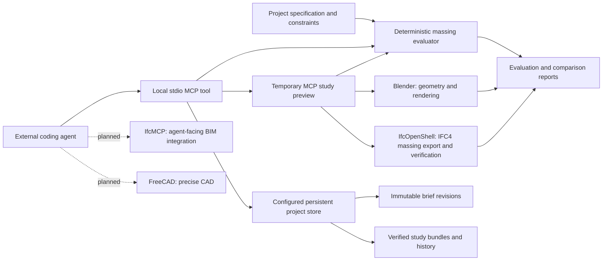

# Proposed architecture

Archy coordinates an architectural workflow around a project specification. An existing agent runtime may interpret the brief and propose changes. Specialized tools perform modeling, BIM, and rendering operations. Archy records the inputs, decisions, and evaluation results needed to review each alternative.

The local Python evaluator, stdio MCP tools for evaluation and persistent project management, Blender massing/rendering workflow, and IfcOpenShell-based IFC4 export and verification are implemented. Connecting a specific agent runtime and adding Blender or IFC editing tools for agents remain planned. FreeCAD is a candidate for later precise CAD work, not a required part of the first proof of concept.

## Project data

The structured specification records the brief, design parameters, constraints, and decisions. The IFC export represents each rectangular alternative as its own `IfcBuilding`, with one `IfcBuildingStorey` per floor and one full-height `IfcBuildingElementProxy`. Storeys record elevations but have no floor geometry. The user-defined `ArchyAlternative` and `ArchyMassing` property sets identify each option and its measurements. The evaluation report remains authoritative for input values; independent IFC verification checks the exported structure, geometry, and properties against that report. Blender scenes and renders are derived artifacts.

## Operations and safety

The first workflow uses the deterministic massing operation contract in [massing-operations.md](massing-operations.md). The initial input example is [massing-brief.yaml](../examples/massing-brief.yaml). These specifications define rectangular site and footprint geometry, area measurements, and constraint results independently of Blender or IFC. MCP project tools accept UUID identifiers and resolve them beneath a server-configured storage directory; callers do not supply filesystem paths. Adapters should expose narrowly scoped, validated actions and work within isolated project directories. Arbitrary Python execution in a Blender integration requires special care. Generated changes and destructive actions must be reviewable.

## Scope and integration policy

Archy is intentionally not a general CAD or BIM authoring tool. It owns the brief, deterministic evaluation, comparison, verification, project history, and agent-facing access. Geometry creation, rendering, IFC authoring, CAD, simulation, and collaboration should be handled by existing tools or separately approved integrations.

Before adding an overlapping capability, investigate upstream contributions or integration with an existing project. Any new capability must state its bounded scope, non-goals, verification method, and licensing/security implications.

## Future implementation

Once the proof of concept works, Rust is a candidate for a CLI, typed operations, project and version management, a backend-independent geometry interface, constraint evaluation, and transactional tool execution. The first milestone does not require Rust.
