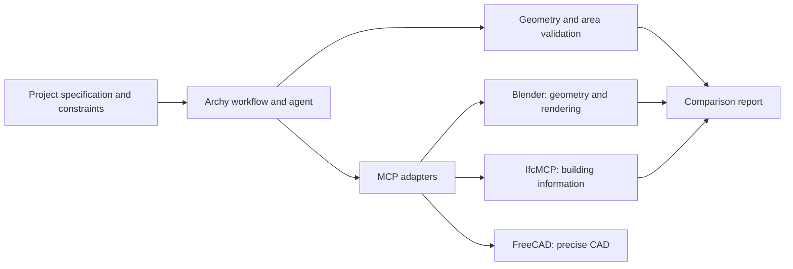

# Proposed architecture

Archy coordinates an architectural workflow around a project specification. An existing agent runtime may interpret the brief and propose changes. Specialized tools perform modeling, BIM, and rendering operations. Archy records the inputs, decisions, and evaluation results needed to review each alternative.

FreeCAD is a candidate for later precise CAD work, not a required part of the first proof of concept. The diagram describes an intended architecture, not existing functionality.

## Project data

The structured specification records the brief, design parameters, constraints, and decisions. IFC carries building information and semantic elements. The proof of concept must define how the specification and IFC correspond, how changes propagate, and which data is authoritative when they disagree. Blender scenes and renders are derived artifacts.

## Operations and safety

The first workflow needs a small set of deterministic architectural operations, with explicit units, inputs, and results. The exact operation contracts remain to be designed. Adapters should expose narrowly scoped, validated actions and work within isolated project directories. Arbitrary Python execution in a Blender integration requires special care. Generated changes and destructive actions must be reviewable.

## Future implementation

Once the proof of concept works, Rust is a candidate for a CLI, typed operations, project and version management, a backend-independent geometry interface, constraint evaluation, and transactional tool execution. The first milestone does not require Rust.
